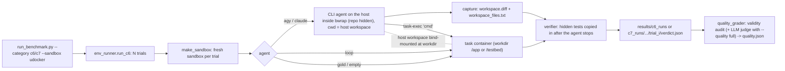

# How containers are integrated in the evaluation harness (C6 / C7)

C1–C5 run agents in a git worktree of `xhs-campaign-service`. C6 (discriminative tasks) and C7
(daily-work tasks) instead run every trial inside the task's own container image. That image is
the same one the source benchmark (Terminal-Bench 2.0, FrontierSWE v2, SWE-bench Verified,
DeepSWE v1.1) publishes. This page explains how that works. How results are scored (pass/fail +
LLM-judge code quality) is in `guide/coding_rubric.md`.

Code:
- `evaluation/env_runner.py`: sandboxes, agents, verifiers, trial runner
- `evaluation/run_benchmark.py`: CLI; `RUNNERS["c6"]` and `RUNNERS["c7"]` both call
  `env_runner.run_c6`
- `evaluation/quality_grader.py`: code-quality grading and validity audit of a recorded trial

## 1. Overview



Per trial (`env_runner.run_trial`):
1. **Start a fresh sandbox** from the entry's `environment` (image, workdir).
2. **Run the agent.** Its work lands in the task workdir (`/app` for Terminal-Bench / FrontierSWE /
   DeepSWE entries, `/testbed` for SWE-bench entries). agy/claude run inside `bwrap` (§3).
3. **Capture the workspace** (agy/claude only): `workspace.diff` (all changes vs the base commit,
   or a before/after diff for non-git workdirs) and `workspace_files.txt` (final listing).
4. **Grade inside the container.** The hidden tests or eval script are copied in only now and run
   by the entry's `verification` → `verdict.json`.
5. **Destroy** the sandbox.
6. **Quality grading** (agy/claude only, `--quality`): `quality_grader.grade_trial` writes
   `quality.json`. `machine` (default) = validity audit only; `full` = also the LLM judge; `off`.

The entry's D1 score is the pass rate over N trials (`--trials`, CLI default 5; our runs use 3),
snapped to the category rubric's tiers. Gold and empty runs use 1 trial because they are
deterministic.

## 2. Sandbox backends (`--sandbox`)

All backends expose the same interface: `workdir`, `ws` (the host dir mounted at the workdir),
`exec(cmd)`, `exec_argv(argv)`, `put_file`, `put_dir`, `read_file`, `close`. Agents and verifiers
never call Docker directly; they go through this interface.

| Backend | Class | How it runs | When to use |
|---|---|---|---|
| `docker` (default) | `DockerSandbox` | Builds the entry's Dockerfile (if present) or pulls `prebuilt_image`, then runs one long-lived container per trial (`docker run -d ... sleep infinity`). Commands go through `docker exec`. Enforces `cpus`, `memory`, `network: false`. | Machines with a Docker daemon. Highest isolation. |
| `udocker` | `UdockerSandbox` | Rootless; no daemon, no sudo. Unpacks the exact image once into a reusable **base container**. Each command is a `udocker run` with per-trial bind mounts, using execmode **R1** (rootless runc; needs user namespaces and `tools/patch_udocker_r1.py`) or else **P1** (proot). `XHS_UDOCKER_EXECMODE` or the entry's `udocker_execmode` override it (C8-02 = P1). | Cloudtop and other hosts without Docker or root. Used for all runs so far. |
| `bwrap` | `BwrapSandbox` | bubblewrap with the **host** `/usr` read-only and no network. | Only for tasks that need nothing beyond host tools (e.g. C6-05). Cannot run tb2_pytest, swebench or harbor_separate verifiers. |

### udocker details

- **Base container per image:** the base is created once (`xhs-base-<image>`), guarded by a
  file lock. Large images take minutes and several GB to unpack (mteb: ~12 GB). Bases are reused
  across trials and are never `udocker rm`-ed by the harness.
- **Per-trial isolation via bind mounts:** fresh host directories are mounted over:
  - the workdir (`/app` or `/testbed`), seeded from the image's own copy
  - `/tmp`, `/logs`, `/tests`
  - any `environment.per_trial_paths` (e.g. C8-02 uses an empty `/root` to hide verifier assets)

  Trials and parallel runs therefore don't see each other's work or the tests.
- **Shared toolchain:** `~/.cache/xhs_c6/opt` is mounted at `/opt/xhs`. It holds `uv`/`uvx` plus
  their caches, so Terminal-Bench graders can run `uvx -p 3.13 -w pytest ...` in any image without
  curl-installing uv each time.
- **Environment variables:** `environment.container_env` is passed as `--env=K=V`.
- **Digest-pinned images:** udocker can't pull `repo@sha256:...`. `tools/fetch_oci_digest.py`
  downloads such an image anonymously from the registry and writes a docker-save tarball with the
  image config, which is then loaded and tagged (`udocker load -i … <repo>`;
  `udocker tag …:fswe-da83f84`). The entry records the alias as `environment.udocker_image`.
- **Limits (fidelity caveats):**
  - no CPU or memory caps
  - network shared with the host
  - udocker (R1 or proot) is not a security boundary
  - the agent runs as fake root (R1 maps only uid 0, so `runuser`/`setuid` fail; such entries use P1)
  - writes outside the bind mounts land in the shared base container

  Timing-sensitive tests are protected by serializing graders (see §5).

## 3. How agents reach the container

| `--agent` | Where it runs | How it uses the container |
|---|---|---|
| `agy` / `claude` | On the **host**, in a temp workspace directory, inside `bwrap` (below) | That directory is bind-mounted as the task workdir inside the container. The agent edits files with its own tools; changes appear in the container immediately. To run commands in the container it calls a generated helper, `task-exec` (below). |
| `loop` | Built-in minimal agent (Gemini API) | Every shell command it proposes runs **inside** the container via `sandbox.exec`. Highest fidelity, but not a production agent. |
| `gold` | — | Runs the entry's reference solution inside the container (validates task + verifier). |
| `empty` | — | Does nothing (checks that an untouched workspace fails). |

### `task-exec` and the prompt footer (agy / claude)

`_write_task_exec` writes `task-exec` into a temp directory outside the repo
(`/tmp/xhs-c6-bin-XXXX/`, removed after the trial), a one-line wrapper around the sandbox's
`exec_argv`. For udocker it looks like:

```bash
#!/bin/bash
exec udocker --quiet run --nobanner -w /app \
  -v /tmp/xhs-c6-host-XXXX:/app -v ~/.cache/xhs_c6/opt:/opt/xhs \
  -v /tmp/xhs-c6-trial-XXXX/tmp:/tmp -v .../logs:/logs -v .../tests:/tests \
  xhs-base-<image> bash -c "$*"
```

`build_host_agent_prompt` appends this footer to the task's original `problem_statement`:

```
---
Environment notes:
- The task environment is a container. Inside it, `/app` is the task directory.
- On your side, `/app` is mounted from your current working directory `<host workspace>`:
  files you create here appear in `/app` inside the container.
- Run commands INSIDE the task environment with: `/tmp/xhs-c6-bin-XXXX/task-exec '<command>'`
  (e.g. `... 'cd /app && ls -la'`). Use it to compile/test with the environment's toolchain.
- Grading happens inside the container after you finish.
- Work only from this task description and the environment. Do not search for or download the
  upstream fix, the original benchmark task, its tests or its reference solution (online or on
  this machine); doing so is treated as a violation.
```

`invoke_agent` (run_benchmark.py) then launches the agent headless, with `cwd` set to the host
workspace, the prompt on stdin, and the isolation prefix from `agent_isolation_prefix`:

```
bwrap --dev-bind / / --die-with-parent --tmpfs /tmp --tmpfs <benchmark repo> --tmpfs <analysis workspace> \
      --tmpfs ~/.gemini/jetski/brain [--tmpfs $XHS_AGENT_MASK...] \
      --bind <workspace> <workspace> --bind <helper dir> <helper dir> --bind <container mounts under /tmp> ... -- \
  agy --input-format text --model <M> --output-format stream-json --dangerously-skip-permissions \
      --print-timeout <budget>m --mode accept-edits --add-dir <workspace>
# claude: claude --print - --model <M> --output-format stream-json --verbose --dangerously-skip-permissions
```

**Isolation (`bwrap`).** The whole host stays visible (the CLIs need their config, credentials and
network), but the benchmark repo (hidden tests, reference solutions, other runs' results), the
analysis workspace around it, conversation artifacts and any `XHS_AGENT_MASK` paths are replaced by
empty tmpfs, and `/tmp` is private except for this trial's paths. Disable with `--no-isolate`
(or when `bwrap` is missing). Before 2026-10-14 agents ran without it and 18 trials read hidden
tests / solutions; the validity audit in `quality_grader.py` flags such trials.

The budget is `min(--timeout, environment.agent_timeout_sec)`. If the agent times out, the
workspace is still graded, as in the source benchmarks.

> [!NOTE]
> Nothing forces a host agent to use `task-exec`: it also has a host shell and could build or
> test with host tools. Only the final workspace counts, and it is always graded inside the
> container. In practice agy follows the instructions; one C6-03 trial called `task-exec` 143
> times. Agents in Terminal-Bench run their shell inside the container, so this is a known
> difference.

## 4. Verification (inside the container)

Tests are never visible to the agent. They are copied in only after the agent exits.

| `verification.type` | Used by | What runs |
|---|---|---|
| `script` | — (supported; former C6-01 used it) | A custom verifier is copied to `container_path` and run; its last stdout line is a JSON verdict `{reward, reason, checks}`. |
| `tb2_pytest` | C6-01, C6-03..06, C7-02, C8-03 | The original Terminal-Bench `tests/` are copied to `/tests`. `bash /tests/grader.sh` runs: the original `test.sh` minus the four curl/uv install lines, with uv from `/opt/xhs`. Reward is read from `/logs/verifier/reward.txt`; per-test results come from the CTRF report. |
| `swebench` | C7-03..08, C8-01 | The diff against `base_commit` is recorded. The official SWE-bench `eval.sh` runs in the instance image (reset test files, apply hidden test patch, run tests). The merged log is graded on the host by swebench's own `get_eval_report` (`evaluation/swebench_grade.py`, run with `~/.cache/xhs_c6/swebench-venv`). Reward = resolved (all FAIL_TO_PASS and PASS_TO_PASS tests pass). |
| `harbor_separate` | C8-02 | As in Harbor's `environment_mode = "separate"`: a **disposable** container is created from the task's *verifier* image, the agent's `/app` is copied in (minus `artifact_excludes`), and `bash /root/tests/test.sh` runs. The reward is continuous (0–1) from `/logs/verifier/reward.txt`; the container is removed afterwards. Currently implemented for udocker only. |
| `deepswe` | C6-02, C6-07, C7-01, C7-09..11 | DeepSWE v1.1, mirroring Harbor's separate mode: the agent's **committed** work (`git diff --binary <base_commit> HEAD`) is collected, then a **fresh sandbox of the same task image** (pristine repo) gets the hidden `tests/` copied to `/tests` and the patch at `/logs/artifacts/model.patch`, and `bash /tests/test.sh` applies it plus the hidden `test.patch` and runs `grader.py`. Reward = 1 iff all FAIL_TO_PASS pass and no PASS_TO_PASS fails (`/logs/verifier/reward.json`). Per-test results are read from the grader's `/logs/verifier/ctrf.json` into `checks` (`FAIL_TO_PASS::<id>` / `PASS_TO_PASS::<id>`; runs before 2026-10-14 only have aggregate ratios). |

Continuous rewards pass at `verification.pass_threshold` (C8-02: 0.1; binary graders default to
1.0). Each trial records both `reward` (pass or fail) and `score` (raw value).

## 5. Reliability measures

- **Grader serialization:** all graders on the host take one file lock
  (`~/.cache/xhs_c6/verify.lock`). Some tests are timing-sensitive (query runtime ≤ 1.05× golden;
  Ctrl-C 0.5 s after start) and flake when several graders compete for CPU. Agents still run in
  parallel.
- **SIGINT restore:** background jobs started from a non-interactive shell inherit
  SIGINT = ignored, and so do all their children. `env_runner` restores the default handler at
  import, so tasks that test Ctrl-C handling (C6-06) behave correctly.
- **Timeouts kill whole process groups** (`_run`), so proot/udocker children don't linger.
- **Infra failures** (sandbox start, image pull) are recorded per trial as `infra_error` and count
  as 0. Rerun when they appear.

## 6. Running

From the XHS repo root:

```bash
# validate an entry (gold must pass, empty must fail)
python3 evaluation/run_benchmark.py --category c8 --entry C8-03 --agent gold  --sandbox udocker
python3 evaluation/run_benchmark.py --category c8 --entry C8-03 --agent empty --sandbox udocker

# agent runs: 3 trials with Antigravity
GOOGLE_APPLICATION_CREDENTIALS=<adc with quota project> \
python3 evaluation/run_benchmark.py --category c8 --entry C8-01 --agent agy \
    --model gemini-3.8-flash-high --sandbox udocker --trials 3

# C8-02 has a 2 h budget: raise --timeout (minutes) so it isn't capped at the default 30
python3 evaluation/run_benchmark.py --category c8 --entry C8-02 --agent agy \
    --model gemini-3.8-flash-high --sandbox udocker --trials 3 --timeout 120

# grade code quality with the LLM judge inline (default --quality machine = validity audit only)
python3 evaluation/run_benchmark.py --category c7 --entry C7-03 --agent claude --model claude-opus-5-5 \
    --sandbox udocker --trials 3 --quality full --judge claude:claude-opus-5-5
```

Other C6/C7 flags: `--no-isolate` (run agents without bwrap), `--quality off|machine|full`,
`--judge kind:model`.

For long runs, detach them so they survive a closed session:
`setsid nohup python3 ... > log 2>&1 < /dev/null &`.

Per-trial outputs are in
`results/<c6|c7>_runs/<entry>_<agent>_<model>_<ts>/trial_<i>/`:
- `verdict.json` (reward, reason, per-test `checks`, verifier details)
- `transcript.json` (final message)
- `trajectory.jsonl` (agy/claude tool calls)
- `workspace.diff`, `workspace_files.txt` (agy/claude, runs since 2026-10-14)
- `quality.json` (+ `judge_v3_<judge>.json` once the LLM judge has run)

The run summary is `results/<category>_<agent>_<model>_<ts>.json`.

## 7. Host setup notes (udocker on Cloudtop)

- **Install:** `uv tool install udocker`. The repository lives in `~/.udocker`.
- **Disk:** each base container is the full unpacked image (SWE-bench Django ~3–4 GB; mteb
  ~12 GB). After a base is created, remove the image layers with `udocker rmi <image>`; bases don't
  depend on them. Exception: keep the layers of verifier images used by `harbor_separate`, because
  a disposable container is created from them for every grading.
- **SWE-bench bases:** `tools/prepare_c7_bases.sh` (written for the pre-restructure C7 IDs) creates them one at a time,
  with a free-disk guard.
- **agy auth:** agy uses the `quota_project_id` from the ADC file. Point
  `GOOGLE_APPLICATION_CREDENTIALS` at a copy of the ADC whose `quota_project_id` has Vertex
  access.

> [!NOTE]
> Under `--sandbox docker`, `DockerSandbox` builds the image from the entry's Dockerfile when one
> exists; otherwise it pulls `prebuilt_image` (e.g. the SWE-bench images, which have no
> Dockerfile). The rebuild is intended. udocker cannot build, so it always runs the published
> image.

> [!WARNING]
> `per_trial_paths`, `container_env` and `harbor_separate` (C8-02) are currently implemented for
> udocker only.
